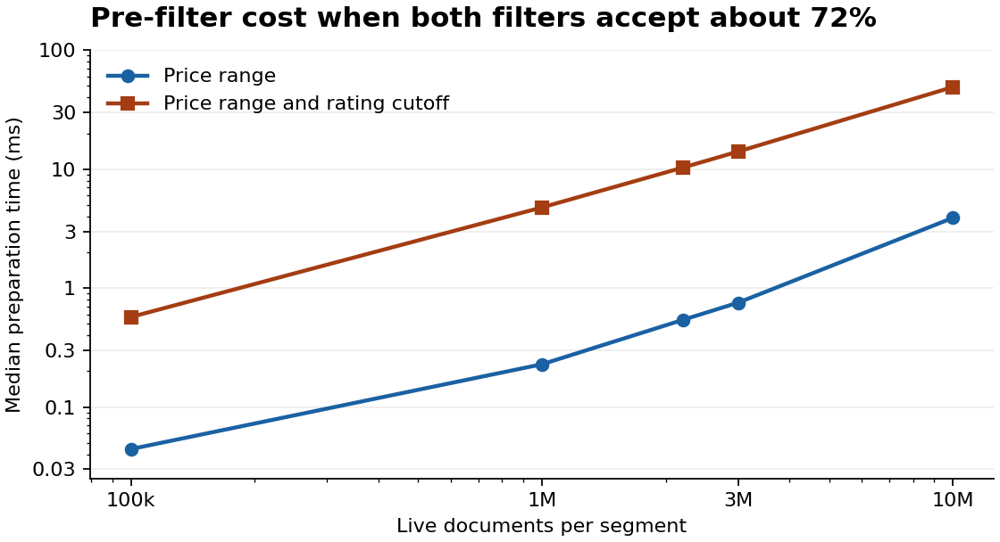

# Synthetic pre-filter harness check

The [real catalog benchmark](catalog/README.md) targets ≥500 ms materializations on roughly 5 GB leaves. The following pilot verified the timing harness on synthetic fixtures.

Eight populated Lucene segments cover 100,000 to 10 million live documents. Two leaves occupy almost the same disk space. The 384-dimensional leaf holds 100,000 documents in 147.1 MiB, while the 16-dimensional leaf holds 2.2 million in 147.4 MiB. Each has one float32 vector and the same two indexed numeric fields per document.

## Measurements

Both filters below accept roughly 72% of each leaf. The first admits prices in the lower 72% of the configured price domain. The second admits prices in the lower 90% and ratings of at least two out of five. Their actual accepted counts are in the summary. All times are medians in milliseconds. The size column sums the bytes in files referenced by the committed segment. Full search includes filter preparation and Lucene vector search, with a candidate count of 100 and result limit of 10.

| Live docs | Vector dimensions | Graph | Segment MiB | Prepare price | Prepare price + rating | Full price | Full price + rating |
| ---: | ---: | --- | ---: | ---: | ---: | ---: | ---: |
| 100,000 | 16 | Flat | 6.7 | 0.044 | 0.572 | — | — |
| 100,000 | 16 | HNSW | 12.8 | 0.026 | 0.534 | 0.270 | 0.810 |
| 100,000 | 384 | Flat | 147.1 | 0.033 | 0.552 | — | — |
| 1,000,000 | 16 | Flat | 66.7 | 0.229 | 4.768 | — | — |
| 1,000,000 | 16 | HNSW | 132.9 | 0.219 | 4.717 | 0.396 | 4.999 |
| 2,200,000 | 16 | Flat | 147.4 | 0.540 | 10.302 | — | — |
| 3,000,000 | 16 | Flat | 201.0 | 0.754 | 14.057 | — | — |
| 10,000,000 | 16 | Flat | 669.8 | 3.895 | 49.036 | — | — |

On the 10M leaf, the single price range accepted 7,199,105 documents and the conjunction accepted 7,200,582. The conjunction took about 13 times longer to prepare. Even within the single-range workload, the 90% range took less time to prepare than the 50% range on this leaf. On the 1M HNSW leaf, median preparation for price plus rating was 4.717 ms, close to the separately measured 4.999 ms median for the full query. Acceptance alone does not explain these costs. Compare streaming against each filter’s measured baseline before choosing an acceptance cutoff.



## Method and scope

- Used the repository’s pinned Lucene core 10.4.0-5, OpenJDK 21.0.13 on Linux, an Intel Core i5-12600K, a 3 GiB maximum JVM heap and the Java vector module. One process issued one query at a time.
- Created separate filesystem indexes and force-merged each to one leaf to control document count. The harness verifies live count, vector count, dimensions and graph size on reopen. Each document has a float32 vector, an integer price in [0, 9999], and a rating in [1, 5]. The two scalar fields have point and numeric doc-values representations. Fixed independent random seeds make corresponding documents comparable across dimensions. These are synthetic distributions with dense vector coverage and zero deletes.
- For each filter, created a fresh weight and iterator-backed `AcceptDocs` with vector-field existence and live-doc handling. Timed the first `cost()` call, including scorer creation, accepted-set construction or reuse within the call, and its cardinality. Verified each count against an independent Lucene searcher count outside the timer. Query rewrite and weight creation are outside this timer.
- Disabled the Lucene query cache and warmed the filesystem cache through indexing and repeated reads. Each leaf and filter had 12 discarded rounds and 25 measured rounds in shuffled predicate order. Reported p95 is the nearest-rank sample percentile. The JVM and machine were shared across successive fixtures, so small timing differences between similar leaves need replication.
- Six fixtures carry vector values with graph construction disabled to isolate preparation economically, including the 10M fixture. The other two have full HNSW graphs. On those two, ran a separate series timing `IndexSearcher.search` with fresh query vectors per round. Materialization and full-search medians come from separate runs. The latter cover Lucene execution within one leaf and exclude mongot request processing, cross-leaf scheduling and rescoring.

The remaining baseline work is to measure production-shaped graphs and sparse or deleted data, mixed segment sizes within one search, concurrent requests, and warm filter reuse versus cold disk reads. These results establish the existing-path costs. Streaming and its crossover remain unmeasured.

## Reproduction and data

Run from the repository root with JDK 21 and `LUCENE_CORE_JAR` set to the pinned fork JAR. Use a new directory for each run. The harness keeps the generated indexes for inspection.

```sh
run_dir=$(mktemp -d)
java -Xms1g -Xmx3g --enable-native-access=ALL-UNNAMED --add-modules jdk.incubator.vector \
  -cp "$LUCENE_CORE_JAR" scripts/perf/VectorPrefilterBenchmark.java \
  "$run_dir/segments" "$run_dir/samples.csv" "$run_dir/search.csv"
```

[Benchmark source](../../../scripts/perf/VectorPrefilterBenchmark.java) · [Per-filter p50 and p95](summary.csv) · [2,000 materialization samples](samples.csv) · [500 full-query samples](search.csv)
